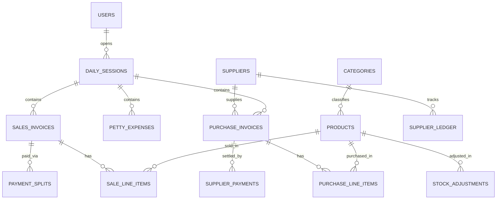
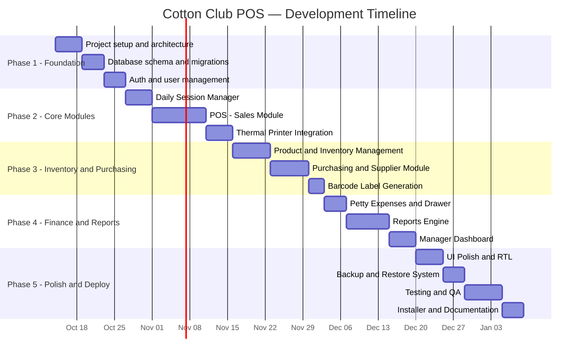

# Technical Implementation Plan
## Cotton Club — Local Sales & Inventory Management System
### Standalone Desktop POS · Offline-First · Single Daily Session Model

> **Source Document**: وثيقة المواصفات الفنية والتنفيذية النهائية — نظام المبيعات والمخزون المحلي  
> **Version**: 1.0  
> **Date**: 2026-10-13  
> **Classification**: Internal — Implementation Reference

---

## Table of Contents

1. [Executive Summary](#1-executive-summary)
2. [System Architecture](#2-system-architecture)
3. [Technology Stack](#3-technology-stack)
4. [Database Design](#4-database-design)
5. [Module Breakdown & Implementation Details](#5-module-breakdown--implementation-details)
6. [User Interface (UI) Specifications](#6-user-interface-ui-specifications)
7. [Access Control & Permissions Matrix](#7-access-control--permissions-matrix)
8. [Security, Backup & Distribution Strategy](#8-security-backup--distribution-strategy)
9. [Development Phases & Timeline](#9-development-phases--timeline)
10. [Testing Strategy](#10-testing-strategy)
11. [Deployment & Distribution](#11-deployment--distribution)
12. [Risks & Mitigations](#12-risks--mitigations)
13. [Appendices](#13-appendices)

---

## 1. Executive Summary

The system is a **standalone desktop application** that operates fully offline, designed to manage a **Point-of-Sale (POS)**, **single warehouse**, and **single cash drawer** for a single retail branch. It follows a **Single Daily Session** model — each business day opens with an initialization event and closes with a full reconciliation.

### Core Business Requirements

| Requirement | Description |
|---|---|
| **Offline Operation** | 100% local — no internet, no LAN, no cloud dependency |
| **Single Branch** | One physical store, one warehouse, one cash register |
| **Daily Session Model** | Open day → transact → close day (no inter-day overlap) |
| **ACID Compliance** | Power-failure-safe transactions; zero data corruption tolerance |
| **Self-Contained Install** | Single `Setup.exe` with all dependencies bundled |
| **Thermal Printing** | Direct 80mm/58mm receipt printing without OS dialog boxes |
| **Barcode Support** | Integrated barcode scanner input + barcode label generation |

---

## 2. System Architecture

### 2.1 High-Level Architecture Diagram

```
┌─────────────────────────────────────────────────────────┐
│                    PRESENTATION LAYER                     │
│  ┌──────────┐ ┌──────────┐ ┌──────────┐ ┌────────────┐  │
│  │  POS     │ │ Inventory│ │Purchasing│ │  Reports   │  │
│  │  Screen  │ │ & Stock  │ │& Vendors │ │ & Dashboard│  │
│  └────┬─────┘ └────┬─────┘ └────┬─────┘ └─────┬──────┘  │
│       └─────────────┴───────────┴──────────────┘         │
│                           │                               │
├───────────────────────────┼───────────────────────────────┤
│                    BUSINESS LOGIC LAYER                    │
│  ┌──────────┐ ┌──────────┐ ┌──────────┐ ┌────────────┐  │
│  │  Sales   │ │ Stock    │ │ Finance  │ │  Session   │  │
│  │  Engine  │ │ Engine   │ │ Engine   │ │  Manager   │  │
│  └────┬─────┘ └────┬─────┘ └────┬─────┘ └─────┬──────┘  │
│       └─────────────┴───────────┴──────────────┘         │
│                           │                               │
├───────────────────────────┼───────────────────────────────┤
│                     DATA ACCESS LAYER                      │
│  ┌──────────────────────────────────────────────────┐    │
│  │    SQLite Engine (Encrypted, WAL Mode, ACID)     │    │
│  │    ┌────────────────────────────────────┐        │    │
│  │    │  Local DB File (single .db file)   │        │    │
│  │    └────────────────────────────────────┘        │    │
│  └──────────────────────────────────────────────────┘    │
│                           │                               │
├───────────────────────────┼───────────────────────────────┤
│                   INFRASTRUCTURE LAYER                     │
│  ┌──────────┐ ┌──────────┐ ┌──────────┐ ┌────────────┐  │
│  │ Thermal  │ │ Barcode  │ │  Backup  │ │  Auto-     │  │
│  │ Printer  │ │ Scanner  │ │  Engine  │ │  Update    │  │
│  └──────────┘ └──────────┘ └──────────┘ └────────────┘  │
└─────────────────────────────────────────────────────────┘
```

### 2.2 Architectural Principles

| Principle | Implementation |
|---|---|
| **Standalone Desktop** | No server, no network, no external database engine |
| **Embedded Database** | SQLite with encryption (SQLCipher or SEE) |
| **ACID Guarantees** | WAL journal mode + `PRAGMA synchronous = FULL` |
| **Power-Failure Safety** | All write operations wrapped in explicit transactions |
| **Single-File Data** | Entire database in one `.db` file for easy backup/restore |
| **OS-Independent Path** | Data stored in `%APPDATA%` or custom path surviving OS reinstall |

---

## 3. Technology Stack

### 3.1 Recommended Stack

| Layer | Technology | Rationale |
|---|---|---|
| **Runtime** | **.NET 8 (LTS)** or **Electron + Node.js** | .NET preferred for Windows desktop performance; Electron as alternative for web-tech teams |
| **UI Framework** | **WPF (XAML)** or **WinForms** | Native Windows rendering, full keyboard/barcode support |
| **Database** | **SQLite 3.x** with **SQLCipher** encryption | Embedded, zero-config, ACID-compliant, encrypted |
| **ORM / Data Access** | **Dapper** (micro-ORM) or raw **ADO.NET** | Lightweight, high-performance SQL mapping |
| **Reporting** | **FastReport** or **RDLC** | PDF/thermal receipt generation |
| **Thermal Printing** | **ESC/POS** protocol via **direct serial/USB** | Bypass OS print dialogs; 80mm & 58mm support |
| **Barcode Generation** | **ZXing.Net** or **BarcodeLib** | Generate barcode labels for items |
| **Installer** | **Inno Setup** or **NSIS** | Single `Setup.exe` with bundled dependencies |
| **Language** | **C#** | Strongly typed, mature ecosystem, excellent SQLite support |

### 3.2 Alternative Stack (Electron-Based)

| Layer | Technology |
|---|---|
| **Runtime** | Electron 28+ |
| **UI** | React/Vue + HTML/CSS |
| **Database** | better-sqlite3 (synchronous, ACID) |
| **Printing** | escpos, node-thermal-printer |
| **Installer** | electron-builder |

> **IMPORTANT**: The **.NET / WPF** stack is **strongly recommended** for this project due to superior thermal printer integration, lower memory footprint, faster startup, and native Windows experience.

---

## 4. Database Design

### 4.1 Entity Relationship Overview



### 4.2 Table Definitions

#### 4.2.1 `users` — System Users

```sql
CREATE TABLE users (
    id              INTEGER PRIMARY KEY AUTOINCREMENT,
    username        TEXT    NOT NULL UNIQUE,
    password_hash   TEXT    NOT NULL,          -- bcrypt or Argon2 hash
    display_name    TEXT    NOT NULL,
    role            TEXT    NOT NULL CHECK(role IN ('manager','cashier')),
    max_petty_cash  REAL    DEFAULT 0,         -- per-transaction limit for cashier
    max_discount_pct REAL   DEFAULT 5.0,       -- max discount % for cashier
    is_active       INTEGER DEFAULT 1,
    created_at      TEXT    DEFAULT (datetime('now','localtime')),
    updated_at      TEXT    DEFAULT (datetime('now','localtime'))
);
```

#### 4.2.2 `categories` — Product Categories

```sql
CREATE TABLE categories (
    id          INTEGER PRIMARY KEY AUTOINCREMENT,
    name        TEXT    NOT NULL UNIQUE,
    description TEXT,
    is_active   INTEGER DEFAULT 1,
    created_at  TEXT    DEFAULT (datetime('now','localtime'))
);
```

#### 4.2.3 `products` — Item Master (الأصناف)

```sql
CREATE TABLE products (
    id              INTEGER PRIMARY KEY AUTOINCREMENT,
    barcode         TEXT    UNIQUE,                -- international or local barcode
    name            TEXT    NOT NULL,               -- commercial name (الاسم التجاري)
    category_id     INTEGER REFERENCES categories(id),
    cost_price      REAL    NOT NULL DEFAULT 0,     -- last purchase cost (سعر التكلفة الأخير)
    sell_price      REAL    NOT NULL DEFAULT 0,     -- consumer sale price (سعر البيع)
    current_stock   REAL    NOT NULL DEFAULT 0,     -- current warehouse qty (الرصيد الحالي)
    reorder_level   REAL    DEFAULT 0,              -- alert threshold (حد إعادة الطلب)
    unit            TEXT    DEFAULT 'piece',        -- unit of measure
    is_active       INTEGER DEFAULT 1,
    created_at      TEXT    DEFAULT (datetime('now','localtime')),
    updated_at      TEXT    DEFAULT (datetime('now','localtime'))
);

CREATE INDEX idx_products_barcode ON products(barcode);
CREATE INDEX idx_products_name    ON products(name);
```

#### 4.2.4 `daily_sessions` — Daily Session Journal (سجل اليوميات)

```sql
CREATE TABLE daily_sessions (
    id              INTEGER PRIMARY KEY AUTOINCREMENT,
    session_date    TEXT    NOT NULL UNIQUE,        -- YYYY-MM-DD
    opened_by       INTEGER NOT NULL REFERENCES users(id),
    opened_at       TEXT    NOT NULL,               -- datetime of opening
    closed_by       INTEGER REFERENCES users(id),
    closed_at       TEXT,                           -- datetime of closing
    opening_cash    REAL    NOT NULL DEFAULT 0,     -- cash carried forward
    status          TEXT    NOT NULL DEFAULT 'open' CHECK(status IN ('open','closed')),
    -- Computed summaries (populated at close)
    total_cash_sales     REAL DEFAULT 0,
    total_card_sales     REAL DEFAULT 0,
    total_transfer_sales REAL DEFAULT 0,
    total_expenses       REAL DEFAULT 0,
    expected_drawer      REAL DEFAULT 0,            -- opening + cash_sales - expenses
    actual_drawer        REAL DEFAULT 0,            -- physically counted cash at close
    variance             REAL DEFAULT 0,            -- actual - expected
    notes                TEXT
);
```

#### 4.2.5 `sales_invoices` — Sales Header (رأس الفاتورة)

```sql
CREATE TABLE sales_invoices (
    id              INTEGER PRIMARY KEY AUTOINCREMENT,
    invoice_number  TEXT    NOT NULL UNIQUE,        -- sequential number (الرقم التسلسلي)
    session_id      INTEGER NOT NULL REFERENCES daily_sessions(id),
    sold_by         INTEGER NOT NULL REFERENCES users(id),
    invoice_date    TEXT    NOT NULL,               -- datetime
    subtotal        REAL    NOT NULL DEFAULT 0,     -- before discount (إجمالي القيمة)
    discount_amount REAL    NOT NULL DEFAULT 0,     -- total discount (الخصم الممنوح)
    net_total       REAL    NOT NULL DEFAULT 0,     -- after discount (صافي الفاتورة)
    payment_method  TEXT    NOT NULL DEFAULT 'cash' 
                    CHECK(payment_method IN ('cash','card','transfer','split')),
    is_cancelled    INTEGER DEFAULT 0,
    cancelled_by    INTEGER REFERENCES users(id),
    cancel_reason   TEXT,
    created_at      TEXT    DEFAULT (datetime('now','localtime'))
);

CREATE INDEX idx_sales_session ON sales_invoices(session_id);
CREATE INDEX idx_sales_date    ON sales_invoices(invoice_date);
```

#### 4.2.6 `sale_line_items` — Sales Detail (بنود الفاتورة)

```sql
CREATE TABLE sale_line_items (
    id              INTEGER PRIMARY KEY AUTOINCREMENT,
    invoice_id      INTEGER NOT NULL REFERENCES sales_invoices(id),
    product_id      INTEGER NOT NULL REFERENCES products(id),
    quantity        REAL    NOT NULL,
    unit_price      REAL    NOT NULL,               -- sell price at time of sale
    cost_price      REAL    NOT NULL,               -- cost snapshot for COGS
    line_discount   REAL    DEFAULT 0,
    line_total      REAL    NOT NULL                 -- (quantity * unit_price) - line_discount
);

CREATE INDEX idx_sale_items_invoice ON sale_line_items(invoice_id);
CREATE INDEX idx_sale_items_product ON sale_line_items(product_id);
```

#### 4.2.7 `payment_splits` — Split Payment (الدفع المجزأ)

```sql
CREATE TABLE payment_splits (
    id              INTEGER PRIMARY KEY AUTOINCREMENT,
    invoice_id      INTEGER NOT NULL REFERENCES sales_invoices(id),
    method          TEXT    NOT NULL CHECK(method IN ('cash','card','transfer')),
    amount          REAL    NOT NULL
);
```

#### 4.2.8 `suppliers` — Vendors (الموردين)

```sql
CREATE TABLE suppliers (
    id              INTEGER PRIMARY KEY AUTOINCREMENT,
    name            TEXT    NOT NULL,
    phone           TEXT,
    address         TEXT,
    opening_balance REAL    DEFAULT 0,              -- initial debt (الرصيد الافتتاحي)
    current_balance REAL    DEFAULT 0,              -- live balance (المديونية الحالية)
    is_active       INTEGER DEFAULT 1,
    created_at      TEXT    DEFAULT (datetime('now','localtime')),
    updated_at      TEXT    DEFAULT (datetime('now','localtime'))
);
```

#### 4.2.9 `purchase_invoices` — Purchase Header (فواتير الشراء)

```sql
CREATE TABLE purchase_invoices (
    id              INTEGER PRIMARY KEY AUTOINCREMENT,
    invoice_number  TEXT    NOT NULL UNIQUE,
    supplier_id     INTEGER NOT NULL REFERENCES suppliers(id),
    session_id      INTEGER REFERENCES daily_sessions(id),
    purchase_date   TEXT    NOT NULL,
    receipt_date    TEXT,                           -- actual goods received date
    total_amount    REAL    NOT NULL DEFAULT 0,
    payment_type    TEXT    NOT NULL DEFAULT 'credit' 
                    CHECK(payment_type IN ('cash','credit')),  -- نقدي فوري / آجل
    paid_amount     REAL    DEFAULT 0,
    notes           TEXT,
    created_by      INTEGER REFERENCES users(id),
    created_at      TEXT    DEFAULT (datetime('now','localtime'))
);
```

#### 4.2.10 `purchase_line_items` — Purchase Detail (بنود فاتورة الشراء)

```sql
CREATE TABLE purchase_line_items (
    id              INTEGER PRIMARY KEY AUTOINCREMENT,
    purchase_id     INTEGER NOT NULL REFERENCES purchase_invoices(id),
    product_id      INTEGER NOT NULL REFERENCES products(id),
    quantity        REAL    NOT NULL,
    unit_cost       REAL    NOT NULL,               -- competitive purchase price
    line_total      REAL    NOT NULL
);
```

#### 4.2.11 `supplier_payments` — Vendor Payments (دفعات المورد)

```sql
CREATE TABLE supplier_payments (
    id              INTEGER PRIMARY KEY AUTOINCREMENT,
    supplier_id     INTEGER NOT NULL REFERENCES suppliers(id),
    purchase_id     INTEGER REFERENCES purchase_invoices(id),
    session_id      INTEGER REFERENCES daily_sessions(id),
    amount          REAL    NOT NULL,
    payment_date    TEXT    NOT NULL,
    payment_source  TEXT    DEFAULT 'drawer',       -- from drawer or external
    notes           TEXT,
    created_by      INTEGER REFERENCES users(id),
    created_at      TEXT    DEFAULT (datetime('now','localtime'))
);
```

#### 4.2.12 `petty_expenses` — Daily Petty Cash (المصروفات النثرية)

```sql
CREATE TABLE petty_expenses (
    id              INTEGER PRIMARY KEY AUTOINCREMENT,
    session_id      INTEGER NOT NULL REFERENCES daily_sessions(id),
    amount          REAL    NOT NULL,
    reason          TEXT    NOT NULL,               -- expense description (سبب الصرف)
    category        TEXT,                           -- hospitality, maintenance, etc.
    spent_by        INTEGER NOT NULL REFERENCES users(id),
    approved_by     INTEGER REFERENCES users(id),
    created_at      TEXT    DEFAULT (datetime('now','localtime'))
);
```

#### 4.2.13 `stock_adjustments` — Inventory Adjustments (تسويات المخزون)

```sql
CREATE TABLE stock_adjustments (
    id              INTEGER PRIMARY KEY AUTOINCREMENT,
    product_id      INTEGER NOT NULL REFERENCES products(id),
    session_id      INTEGER REFERENCES daily_sessions(id),
    adjustment_type TEXT    NOT NULL CHECK(adjustment_type IN ('shortage','damage','surplus','correction')),
    quantity_change REAL    NOT NULL,               -- negative for shortage/damage, positive for surplus
    reason          TEXT    NOT NULL,
    adjusted_by     INTEGER NOT NULL REFERENCES users(id),
    created_at      TEXT    DEFAULT (datetime('now','localtime'))
);
```

#### 4.2.14 `app_settings` — Application Configuration

```sql
CREATE TABLE app_settings (
    key             TEXT    PRIMARY KEY,
    value           TEXT,
    description     TEXT,
    updated_at      TEXT    DEFAULT (datetime('now','localtime'))
);

-- Default settings
INSERT INTO app_settings (key, value, description) VALUES
    ('store_name',      'Cotton Club',            'Store display name'),
    ('receipt_header',  'Cotton Club\nWelcome!',  'Receipt header text'),
    ('receipt_footer',  'Thank you!',             'Receipt footer text'),
    ('receipt_width',   '80',                     'Thermal printer width: 80 or 58'),
    ('currency_symbol', 'EGP',                    'Currency symbol'),
    ('backup_path',     '',                       'External backup folder path'),
    ('max_cashier_discount', '5',                 'Max discount % for cashier role'),
    ('max_cashier_petty',    '500',               'Max petty cash per transaction for cashier');
```

#### 4.2.15 `audit_log` — Audit Trail

```sql
CREATE TABLE audit_log (
    id              INTEGER PRIMARY KEY AUTOINCREMENT,
    user_id         INTEGER REFERENCES users(id),
    action          TEXT    NOT NULL,               -- 'cancel_invoice', 'price_change', etc.
    entity_type     TEXT,                           -- 'invoice', 'product', 'session'
    entity_id       INTEGER,
    old_value       TEXT,                           -- JSON snapshot of old state
    new_value       TEXT,                           -- JSON snapshot of new state
    ip_address      TEXT,
    created_at      TEXT    DEFAULT (datetime('now','localtime'))
);
```

---

## 5. Module Breakdown & Implementation Details

### 5.1 Module 1: Daily Session Manager (إدارة اليومية)

#### Functional Scope
- **Open Day**: Record opening time, user, opening cash balance
- **Close Day**: Calculate totals, compare expected vs actual drawer, generate summary
- **Enforce Single Open Session**: Only one session can be `open` at any time
- **Prevent Inter-Day Overlap**: Cannot open a new day without closing the previous one

#### Business Logic

```
OPEN DAY:
  1. Verify no session currently open
  2. Prompt for opening cash amount (carried from previous day or fresh count)
  3. Insert daily_sessions record with status='open'
  4. Log audit entry
  5. Enable POS and transaction screens

CLOSE DAY:
  1. Calculate expected_drawer = opening_cash 
       + SUM(cash_sales) 
       - SUM(cash_purchases) 
       - SUM(petty_expenses)
       - SUM(cash_supplier_payments)
  2. Prompt manager for actual_drawer (physical count)
  3. variance = actual_drawer - expected_drawer
  4. Update session with all computed totals
  5. Set status = 'closed'
  6. Trigger automatic backup
  7. Generate & optionally print closing summary report
```

#### Key Constraints
- All sales, purchases, and expenses MUST reference an active (open) session
- Closing requires **Manager** role authentication
- Backup is auto-triggered upon successful close

---

### 5.2 Module 2: Point of Sale — POS (نقطة البيع)

#### Functional Scope
- Fast keyboard-driven invoice creation
- Barcode scanner integration (acts as keyboard input)
- Split payment support (cash + card + transfer in one invoice)
- Instant stock deduction upon invoice completion
- Direct thermal receipt printing (no OS dialog)

#### Keyboard Shortcuts

| Key | Action |
|---|---|
| **F1** | Focus search box — search by name or barcode |
| **F12** | Add new line item to invoice |
| **F10** | Finalize invoice & print receipt |
| **F4** | Apply discount to current invoice |
| **F5** | Select payment method |
| **Esc** | Cancel / clear current invoice |
| **Enter** | Confirm current line / move to next field |
| **↑ / ↓** | Navigate invoice line items |

#### Invoice Flow

```
1. Cashier scans barcode or presses F1 to search
2. Product auto-populates: name, price, qty=1
3. Cashier adjusts quantity if needed
4. Repeat for all items
5. F4 → Apply discount (cashier limited to max_discount_pct)
6. F5 → Choose payment: Cash / Card / Transfer / Split
   - If Split: prompt for cash amount, card amount, transfer amount
   - Validate: sum of splits = net_total
7. F10 → Finalize:
   a. BEGIN TRANSACTION
   b. INSERT sales_invoice header
   c. INSERT sale_line_items (loop)
   d. INSERT payment_splits if split payment
   e. UPDATE products SET current_stock -= qty (for each item)
   f. COMMIT
   g. Send ESC/POS commands to thermal printer
   h. Clear POS screen for next customer
```

#### Invoice Cancellation
- **Manager only** — requires manager password if logged in as cashier
- Creates reversal: restores stock quantities, logs audit entry
- Original invoice marked `is_cancelled = 1` (never deleted)

---

### 5.3 Module 3: Inventory & Stock Management (الأصناف والمخزون)

#### Functional Scope
- Product CRUD (add, edit, search, deactivate)
- Barcode assignment and label printing
- Quick inventory count (جرد سريع)
- Stock adjustments (shortage, damage, surplus) with mandatory reason

#### Stock Adjustment Flow

```
1. Manager selects product
2. System displays: current_stock (system) vs counted (physical)
3. Manager enters physical count
4. System calculates difference:
   - Negative = shortage/damage
   - Positive = surplus
5. Manager selects reason type and provides description
6. BEGIN TRANSACTION
   a. INSERT stock_adjustment record
   b. UPDATE products SET current_stock = new_physical_count
   c. COMMIT
7. Log audit entry
```

#### Reorder Alerts
- On product load: check `current_stock <= reorder_level`
- Display warning badge/icon on products below threshold
- Dedicated report: "Items Below Reorder Level" for purchase planning

---

### 5.4 Module 4: Purchasing & Supplier Management (المشتريات والموردين)

#### Functional Scope
- Supplier CRUD with contact details and opening balance
- Purchase invoice entry with line items
- Instant stock increase upon purchase entry
- Payment type: **Cash** (deducted from drawer) or **Credit** (added to supplier balance)
- Supplier ledger: detailed statement of purchases, payments, and outstanding balance
- Barcode label generation for newly received items

#### Purchase Flow

```
1. Manager selects or creates supplier
2. Creates purchase invoice header
3. Adds line items (product, qty, unit_cost)
4. Selects payment type:
   - Cash → amount deducted from drawer (petty cash-style)
   - Credit → amount added to supplier.current_balance
5. BEGIN TRANSACTION
   a. INSERT purchase_invoice header
   b. INSERT purchase_line_items (loop)
   c. UPDATE products SET current_stock += qty, cost_price = new_cost
   d. If cash: INSERT supplier_payment, adjust drawer
   e. If credit: UPDATE suppliers SET current_balance += amount
   f. COMMIT
6. Optionally generate barcode labels for received items
```

#### Supplier Ledger
- Show all transactions for a supplier within a date range
- Opening balance → purchases → payments → closing balance
- Printable statement

---

### 5.5 Module 5: Cash Drawer & Petty Expenses (الدرج والمصروفات)

#### Functional Scope
- Record petty expenses (hospitality, maintenance, utilities) against the open session
- Cashier has a configurable per-transaction spending limit
- Drawer balance tracked in real-time throughout the day

#### Petty Expense Entry

```
1. User enters: amount, reason/description, expense category
2. System validates:
   - If cashier: amount <= max_cashier_petty setting
   - If exceeds: prompt for manager password
3. BEGIN TRANSACTION
   a. INSERT petty_expense record
   b. COMMIT
4. Drawer balance recalculated on dashboard
```

---

### 5.6 Module 6: Reports & Manager Dashboard (التقارير ولوحة التحكم)

#### Report Catalog

| # | Report Name | Description | Access |
|---|---|---|---|
| 1 | **Real Profit Report** | Net Profit = Total Sales - COGS - Petty Expenses | Manager |
| 2 | **Top Selling Items** | Ranked by quantity/revenue over a period | Manager |
| 3 | **Slow-Moving Items** | Items with zero or minimal sales | Manager |
| 4 | **Reorder List** | Items at or below reorder threshold | Manager |
| 5 | **Daily Session Summary** | Full breakdown of a closed day | Manager |
| 6 | **Supplier Ledger** | Statement of account per supplier | Manager |
| 7 | **Sales by Payment Method** | Cash vs Card vs Transfer breakdown | Manager |
| 8 | **Expense Summary** | Petty expenses grouped by category/date | Manager |
| 9 | **Stock Valuation** | Current inventory × cost price | Manager |
| 10 | **Cashier Performance** | Sales totals per cashier per day | Manager |

#### Real Profit Calculation

```
Net Profit = Σ(sale_line_items.line_total) 
           - Σ(sale_line_items.cost_price × sale_line_items.quantity)   [COGS]
           - Σ(petty_expenses.amount)
           
For a given date range or session.
```

---

## 6. User Interface (UI) Specifications

### 6.1 Screen Map

```
┌──────────────────────────────────────────────────┐
│                  MAIN WINDOW                      │
│  ┌────────────────────────────────────────────┐  │
│  │           TOP NAVIGATION BAR               │  │
│  │  [POS] [Inventory] [Purchases] [Expenses]  │  │
│  │  [Reports] [Settings]        [User] [Exit] │  │
│  └────────────────────────────────────────────┘  │
│  ┌────────────────────────────────────────────┐  │
│  │                                            │  │
│  │           ACTIVE MODULE CONTENT            │  │
│  │                                            │  │
│  │                                            │  │
│  └────────────────────────────────────────────┘  │
│  ┌────────────────────────────────────────────┐  │
│  │  STATUS BAR: Session#, User, Drawer, Time  │  │
│  └────────────────────────────────────────────┘  │
└──────────────────────────────────────────────────┘
```

### 6.2 POS Screen Layout

```
┌──────────────────────────────────────────────────────────────┐
│  F1: Search  │  Session: #42  │  Cashier: Ahmed  │  14:30   │
├──────────────────────────────────────────────────────────────┤
│                                                              │
│  ┌─────────────────────────────────────────┐  ┌───────────┐ │
│  │  SEARCH / BARCODE INPUT BAR             │  │  PRODUCT  │ │
│  └─────────────────────────────────────────┘  │  QUICK    │ │
│                                                │  INFO     │ │
│  ┌─────────────────────────────────────────┐  │           │ │
│  │  # │ Barcode │ Name │ Qty │ Price │ Tot │  │  Stock:   │ │
│  │  1 │ 6001... │ T-Sh │  2  │ 150   │ 300 │  │  Price:   │ │
│  │  2 │ 6002... │ Jean │  1  │ 450   │ 450 │  │  Category │ │
│  │  3 │         │      │     │       │     │  └───────────┘ │
│  │    │         │      │     │       │     │                │
│  └─────────────────────────────────────────┘                │
│                                                              │
│  ┌──────────────────────────────────────────────────────────┐│
│  │  Subtotal: 750  │  Discount: 0  │  NET TOTAL: 750 EGP  ││
│  │  [F4 Discount] [F5 Payment] [F10 Finalize] [Esc Cancel] ││
│  └──────────────────────────────────────────────────────────┘│
└──────────────────────────────────────────────────────────────┘
```

### 6.3 Thermal Receipt Template (80mm)

```
================================
       COTTON CLUB
    Your Fashion Destination
================================
Date: 2026-10-13   Time: 14:30
Invoice#: INV-2026-001234
Cashier: Ahmed
Session: #42
--------------------------------
Item           Qty  Price  Total
T-Shirt Blue     2   150    300
Jeans Classic    1   450    450
--------------------------------
Subtotal:                   750
Discount:                     0
================================
NET TOTAL:              750 EGP
================================
Payment: Cash
--------------------------------
       Thank you!
    Visit us again soon.
================================
```

### 6.4 UI Design Guidelines

| Aspect | Specification |
|---|---|
| **Font** | Arabic-supporting font (e.g., Cairo, Tajawal, or Segoe UI) |
| **RTL Support** | Full right-to-left layout for Arabic interface |
| **Color Scheme** | Professional dark/light theme with high contrast |
| **Font Size** | POS items: 14pt minimum for readability |
| **Touch/Keyboard** | Designed primarily for keyboard; large buttons for optional touch |
| **Alerts** | Color-coded: Red (critical), Orange (warning), Green (success) |
| **Loading States** | Spinner/progress bar for operations > 500ms |

---

## 7. Access Control & Permissions Matrix

### 7.1 Role Definitions

| Role | Description |
|---|---|
| **Manager (مدير)** | Full system access. Can configure, override, and view all data. |
| **Cashier (كاشير)** | POS operations only. Restricted from pricing, purchasing, and profit reports. |

### 7.2 Detailed Permissions Matrix

| Function | Manager | Cashier | Constraints & Rules |
|---|---|---|---|
| Issue sales invoices (POS) | ✅ | ✅ | Primary daily workflow for both roles |
| Modify item sell price manually | ✅ | ❌ | Price field locked for cashier to prevent unauthorized pricing |
| Grant invoice discount | ✅ | ✅ (limited) | Cashier up to **5% only**; above 5% requires manager password |
| Cancel a finalized/printed invoice | ✅ | ❌ | Requires direct manager authorization; event logged in audit trail |
| Record petty expense from drawer | ✅ | ✅ (limited) | Manager sets max per-transaction limit for cashier |
| Add/edit products & cost prices | ✅ | ❌ | Inventory & pricing screens completely hidden from cashier |
| Enter purchase invoices & manage suppliers | ✅ | ❌ | Procurement and vendor management is management-only |
| View profit reports & cost data | ✅ | ❌ | COGS, margins, and profit fields hidden from cashier UI |
| Open/Close daily session | ✅ | ❌ (open only) | Cashier can open day; only manager can close |
| System settings & user management | ✅ | ❌ | Full admin panel access for manager only |
| Stock adjustments (shortage/surplus) | ✅ | ❌ | Inventory corrections require manager authorization |

### 7.3 Authentication Flow

```
1. Application starts → Login screen
2. User enters username + password
3. System validates against bcrypt hash in users table
4. Role loaded → UI adapts:
   - Cashier: sees POS, petty expenses (limited), basic search
   - Manager: sees all modules, reports, settings
5. Sensitive operations (cancel invoice, override discount):
   - Prompt for manager credentials even during cashier session
   - Log the override event in audit_log
```

---

## 8. Security, Backup & Distribution Strategy

### 8.1 Data Security

| Measure | Implementation |
|---|---|
| **Database Encryption** | SQLCipher AES-256 encryption on the `.db` file |
| **Password Hashing** | bcrypt with salt (cost factor 12+) |
| **Audit Trail** | All sensitive operations logged with user, timestamp, old/new values |
| **Session Locking** | Auto-lock after X minutes of inactivity; require re-authentication |
| **Data Path** | Store DB in `%APPDATA%\CottonClub\data\` — survives OS reinstall |

### 8.2 Backup Strategy

#### Automatic Backup (on Day Close)

```
1. Day close triggered by manager
2. System creates compressed backup:
   Filename: backup_YYYY-MM-DD_HHmmss.zip
   Contents: encrypted .db file + metadata.json
3. Stored in: %APPDATA%\CottonClub\backups\
4. Retention: keep last 30 daily backups (auto-rotate)
5. Optional: one-click export to external folder (USB, external drive)
```

#### Manual Backup

```
- Manager can trigger manual backup at any time
- Same format as auto-backup
- Can choose destination folder
```

#### Restore Flow

```
1. Manager navigates to Settings → Backup → Restore
2. Select backup file (.zip)
3. System validates backup integrity (checksum)
4. Confirmation dialog with warnings
5. Current DB backed up first (safety)
6. Restore backup DB
7. Restart application
```

### 8.3 Distribution & Installation

#### Installer Requirements

| Aspect | Specification |
|---|---|
| **Format** | Single `Setup.exe` (Inno Setup or NSIS) |
| **Size** | Target < 100MB |
| **Dependencies** | .NET Runtime bundled (self-contained publish) |
| **Fonts** | Arabic fonts bundled (Cairo, Tajawal) |
| **No External DB** | SQLite embedded — no server installation needed |
| **Default Install Path** | `C:\Program Files\CottonClub\` |
| **Data Path** | `%APPDATA%\CottonClub\` (separate from install) |
| **Desktop Shortcut** | Auto-created during installation |
| **Uninstaller** | Clean uninstall with option to preserve data |

#### Build Pipeline

```
1. Compile application (Release mode, self-contained)
2. Embed SQLite native libraries
3. Include thermal printer drivers/ESC/POS libraries
4. Include default database with schema + seed data
5. Bundle fonts and assets
6. Package with Inno Setup
7. Sign executable (optional but recommended)
8. Output: CottonClub_Setup_v1.0.0.exe
```

---

## 9. Development Phases & Timeline

### Phase Overview



### Detailed Phase Breakdown

#### Phase 1: Foundation (≈13 days)

| Task | Duration | Deliverables |
|---|---|---|
| Project scaffolding & solution structure | 2 days | Solution, projects, folder structure |
| Architecture patterns (MVVM/MVP) setup | 3 days | Base classes, DI container, navigation framework |
| SQLite + SQLCipher integration | 2 days | DB connection manager, encryption setup |
| Database schema creation & seed data | 2 days | All tables, indexes, default data |
| Authentication system (login, hashing, roles) | 3 days | Login screen, user CRUD, role enforcement |
| Base UI shell (navigation, status bar) | 1 day | Main window with navigation framework |

#### Phase 2: Core POS Module (≈20 days)

| Task | Duration | Deliverables |
|---|---|---|
| Daily Session open/close logic | 5 days | Session manager service, open/close UI |
| POS screen layout & keyboard bindings | 3 days | Full POS UI with F-key shortcuts |
| Product search (barcode + name) | 2 days | Fast search with autocomplete |
| Invoice line item management | 3 days | Add, edit, remove line items |
| Discount logic (percentage + manager override) | 2 days | Discount dialog, permission check |
| Payment processing (cash, card, split) | 3 days | Payment selection, split UI, validation |
| Invoice finalization (transaction + stock deduction) | 2 days | Atomic save with stock update |
| ESC/POS thermal printer integration | 3 days | Direct printing 80mm/58mm |
| Invoice cancellation with reversal | 2 days | Cancel flow, stock restoration, audit log |

#### Phase 3: Inventory & Purchasing (≈17 days)

| Task | Duration | Deliverables |
|---|---|---|
| Product CRUD screens | 3 days | Add/edit/search/deactivate products |
| Category management | 1 day | Category CRUD |
| Stock adjustment screen | 3 days | Count, adjust, reason, audit |
| Supplier CRUD | 2 days | Add/edit/search suppliers |
| Purchase invoice entry | 4 days | Header + line items + payment |
| Supplier ledger/statement | 2 days | Filtered statement with balance |
| Barcode label generation & printing | 2 days | Generate + print barcode labels |

#### Phase 4: Finance & Reports (≈17 days)

| Task | Duration | Deliverables |
|---|---|---|
| Petty expense entry screen | 2 days | Expense form, limit validation |
| Drawer balance tracking | 2 days | Real-time drawer calculation |
| Report engine setup | 2 days | Report framework, PDF export |
| Profit report | 2 days | Sales - COGS - expenses calculation |
| Top/slow-moving items report | 2 days | Ranked product analysis |
| Reorder list report | 1 day | Below-threshold items |
| Session summary report | 2 days | Full daily breakdown |
| Supplier & payment reports | 2 days | Vendor statements |
| Manager dashboard | 2 days | KPI cards, charts, quick actions |

#### Phase 5: Polish & Deployment (≈20 days)

| Task | Duration | Deliverables |
|---|---|---|
| RTL Arabic UI polish | 3 days | Full RTL layout, Arabic fonts |
| UI animations & transitions | 2 days | Smooth navigation, loading states |
| Backup & restore system | 4 days | Auto-backup, manual backup, restore |
| Settings screen | 2 days | Store info, receipt config, preferences |
| Integration testing | 3 days | End-to-end workflow testing |
| User acceptance testing | 2 days | Real-world scenario testing |
| Bug fixes & performance | 2 days | Issue resolution, optimization |
| Installer creation | 1 day | Inno Setup packaging |
| User documentation | 1 day | Quick start guide |

### Total Estimated Timeline

| Phase | Duration | Cumulative |
|---|---|---|
| Phase 1: Foundation | ~13 days | 13 days |
| Phase 2: Core POS | ~20 days | 33 days |
| Phase 3: Inventory & Purchasing | ~17 days | 50 days |
| Phase 4: Finance & Reports | ~17 days | 67 days |
| Phase 5: Polish & Deploy | ~20 days | **87 days (~4 months)** |

> **NOTE**: Timeline assumes a **single developer** working full-time. With 2 developers, Phases 2-4 can be parallelized, reducing total to approximately **60 days (~3 months)**.

---

## 10. Testing Strategy

### 10.1 Testing Levels

| Level | Scope | Tools |
|---|---|---|
| **Unit Tests** | Business logic, calculations, data access | xUnit / NUnit, Moq |
| **Integration Tests** | Database operations, transaction integrity | In-memory SQLite, test fixtures |
| **UI Tests** | Screen flows, keyboard navigation | Manual + coded UI tests |
| **System Tests** | Full end-to-end workflows | Scenario-based manual testing |
| **Performance Tests** | Large dataset handling, search speed | Benchmarks with 10K+ products |

### 10.2 Critical Test Scenarios

| # | Scenario | Expected Outcome |
|---|---|---|
| 1 | Power failure during invoice save | Transaction rolls back; no partial data |
| 2 | Cashier attempts discount > 5% | System prompts for manager password |
| 3 | Sell item with zero stock | Warning displayed; sale blocked or warned |
| 4 | Close day with drawer variance | Variance recorded; session closes with notes |
| 5 | Cancel finalized invoice | Stock restored; audit log entry created |
| 6 | Search 10,000 products by partial name | Results returned < 200ms |
| 7 | Print receipt on 80mm and 58mm printers | Correct formatting on both widths |
| 8 | Backup and restore cycle | Data integrity verified after restore |
| 9 | Multiple payment methods (split) | Amounts correctly distributed and recorded |
| 10 | Concurrent session prevention | Only one session open at a time |

---

## 11. Deployment & Distribution

### 11.1 Build Checklist

- [ ] Compile in Release mode (self-contained, single-file optional)
- [ ] SQLite native binaries included for x86 and x64
- [ ] Arabic fonts bundled
- [ ] Default database with schema + seed data
- [ ] ESC/POS printer libraries included
- [ ] App settings with sensible defaults
- [ ] Inno Setup script finalized
- [ ] Installer tested on clean Windows 10/11

### 11.2 First-Run Experience

```
1. User runs Setup.exe → installs to Program Files
2. First launch → detects no database
3. Creates default database in %APPDATA%\CottonClub\
4. Prompts to create initial Manager account
5. Manager enters store name, receipt header/footer
6. Ready to use — manager can create cashier accounts
```

### 11.3 Update Strategy

- Manual update via new `Setup.exe` (v1.x approach)
- Installer detects existing installation and upgrades
- Database migration scripts auto-applied on version change
- Data preserved during upgrade

---

## 12. Risks & Mitigations

| # | Risk | Impact | Probability | Mitigation |
|---|---|---|---|---|
| 1 | Data corruption from power failure | Critical | Medium | ACID transactions, WAL mode, auto-backup |
| 2 | Thermal printer compatibility issues | High | Medium | Support common ESC/POS printers; test top 5 brands |
| 3 | Arabic RTL rendering bugs | Medium | Medium | Thorough RTL testing; use well-supported fonts |
| 4 | Database file grows too large | Medium | Low | Periodic VACUUM; archive old sessions |
| 5 | User forgets manager password | High | Medium | Recovery mechanism via security question or master key |
| 6 | Barcode scanner incompatibility | Medium | Low | Use keyboard-wedge scanners (universal) |
| 7 | Slow search with large product catalog | Medium | Low | Proper indexing; FTS5 for full-text search |
| 8 | Installer blocked by antivirus | Medium | Medium | Code-sign the executable; test with top AV solutions |

---

## 13. Appendices

### Appendix A: Project Folder Structure

```
CottonClub/
├── src/
│   ├── CottonClub.Core/              # Business logic, domain models
│   │   ├── Models/
│   │   ├── Services/
│   │   ├── Interfaces/
│   │   └── Enums/
│   ├── CottonClub.Data/              # Data access, repositories
│   │   ├── Database/
│   │   ├── Repositories/
│   │   ├── Migrations/
│   │   └── Queries/
│   ├── CottonClub.UI/                # WPF/WinForms UI
│   │   ├── Views/
│   │   ├── ViewModels/
│   │   ├── Controls/
│   │   ├── Converters/
│   │   ├── Assets/
│   │   │   ├── Fonts/
│   │   │   └── Icons/
│   │   └── Themes/
│   ├── CottonClub.Printing/          # ESC/POS & receipt generation
│   │   ├── Thermal/
│   │   ├── Barcode/
│   │   └── Templates/
│   └── CottonClub.Backup/            # Backup & restore logic
├── tests/
│   ├── CottonClub.Core.Tests/
│   ├── CottonClub.Data.Tests/
│   └── CottonClub.Integration.Tests/
├── installer/
│   └── setup.iss                      # Inno Setup script
├── docs/
│   ├── user-guide.md
│   └── api-reference.md
└── CottonClub.sln
```

### Appendix B: Key Configuration Constants

| Constant | Default | Description |
|---|---|---|
| `DB_FILENAME` | `cottonclub.db` | Database file name |
| `DB_PATH` | `%APPDATA%\CottonClub\data\` | Database storage path |
| `BACKUP_PATH` | `%APPDATA%\CottonClub\backups\` | Backup storage path |
| `MAX_BACKUP_COUNT` | `30` | Number of auto-backups to retain |
| `RECEIPT_WIDTH_80` | `48 chars` | Character width for 80mm paper |
| `RECEIPT_WIDTH_58` | `32 chars` | Character width for 58mm paper |
| `SESSION_TIMEOUT_MIN` | `15` | Auto-lock after inactivity (minutes) |
| `SEARCH_DEBOUNCE_MS` | `150` | Debounce delay for search input |
| `INVOICE_PREFIX` | `INV` | Invoice number prefix |

### Appendix C: Arabic-English Term Glossary

| Arabic Term (المصطلح) | English Translation | System Entity |
|---|---|---|
| يومية | Daily Session | `daily_sessions` |
| فاتورة بيع | Sales Invoice | `sales_invoices` |
| بنود الفاتورة | Line Items | `sale_line_items` |
| أصناف | Products/Items | `products` |
| مخزون | Inventory/Stock | `products.current_stock` |
| مورد | Supplier/Vendor | `suppliers` |
| فاتورة شراء | Purchase Invoice | `purchase_invoices` |
| مصروفات نثرية | Petty Expenses | `petty_expenses` |
| درج النقدية | Cash Drawer | Computed from session data |
| كاشير | Cashier | `users` (role=cashier) |
| مدير | Manager | `users` (role=manager) |
| جرد | Inventory Count | `stock_adjustments` |
| باركود | Barcode | `products.barcode` |
| خصم | Discount | `sales_invoices.discount_amount` |
| حد إعادة الطلب | Reorder Level | `products.reorder_level` |
| تكلفة البضاعة المباعة | COGS | Computed from `sale_line_items` |

---

*End of Technical Implementation Plan*
